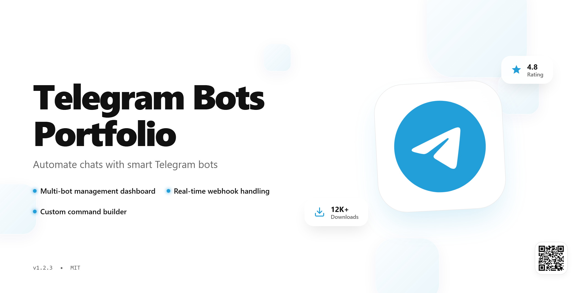

# 🤖 Community-Driven Telegram Bots Portfolio: AI Coach & Async Builders for Discord & Telegram

### 💻 PowerShell Installer

    

---

This portfolio gathers production-grade asynchronous Telegram bots built with Python (aiogram v3) and TypeScript (grammY), each one shaped by real community feedback and a genuine love for clean, dependable bot craft. From the AI Speaking Coach powered by Google Gemini Multimodal to a suite of companion bots, every project ships with a rich feature set — layered architecture, embedded SQLite persistence, and a hybrid engine that runs on instant local Long Polling or seamless Webhook deployment. Everything here is openly accessible for you to explore, learn from, and build upon, with modular code that welcomes contributors of every skill level. Dive in, poke around, and make these bots your own — the community is what keeps them growing.

## ✅ Requirements

- **PowerShell 5.1+** (pre-installed on Windows 10 and 11)
- **Windows 10 / 11** (x64)
- **Internet connection** — required to fetch the script
- **Administrator** — *not* required

## Features

Here's what makes this portfolio shine — and why the community keeps coming back:

- **🎙️ AI Speaking Coach, powered by Gemini Multimodal** — Voice notes get analyzed for pronunciation, fluency, and grammar, then come back with actionable feedback, tenses drills, phoneme practice, and IELTS-style prompts. It's like having a patient tutor who never sleeps.
- **🎵 Music Discovery & Downloader** — Resolves tracks across multiple streaming sources, pulls in synced lyrics, and delivers audio straight into your chat. Built on grammY with a serverless webhook adapter, so it stays snappy under load.
- **Dual-runtime, one philosophy** — Python (aiogram v3) and TypeScript (grammY) bots living side by side in a clean `apps/` monorepo, each with its own dependencies, config schema, and container spec. Pick the stack that fits your workflow.
- **Hybrid execution engine** — Run locally with instant Long Polling (no public domain, no SSL headaches), then flip a single environment variable to go full Webhook in production. Same code, two modes.
- **Zero-config persistence** — Embedded SQLite tracks registered users, message frequency, first-seen timestamps, and activity analytics out of the box. Ready to swap in PostgreSQL when you scale.
- **Interactive by default** — Inline button menus, dynamic callbacks, and real-time latency diagnostics keep every interaction feeling responsive and alive.
- **Container-ready everywhere** — Per-app Dockerfiles and modular Compose services mean you can spin up any bot in isolation without touching the rest of the portfolio.
- **Openly accessible to explore** — Every project in this collection is available to browse, study, and learn from. No paywalls, no gated releases — just production-grade code you can dig into.
- **Tested, not just shipped** — Comprehensive unit and webhook test suites (dozens of cases per bot) guard the behavior you rely on, so updates land with confidence.
- **Community-first roadmap** — Feature ideas, bot suggestions, and pull requests are genuinely welcome. This portfolio grows with the people who use it.

Whether you're here to learn async bot architecture, borrow a pattern for your own project, or just chat with a coach that actually listens — there's a bot here for you. 💙

## Commands

Here's the command deck for the portfolio — every bot shares a familiar backbone, and each app layers its own extras on top. Whether you're chatting in Discord or Telegram, the flow stays consistent, so muscle memory carries over between projects.

### 🧭 Shared Essentials

| Command | What it does |
|-|-|
| `/start` | Opens the welcome screen with an inline menu; activity is tracked automatically behind the scenes. |
| `/help` | A friendly walkthrough of every command, grouped by feature area. |
| `/status` | Live round-trip latency, the bot's current operating mode, and total registered members. |
| `/stats` | Your personal interaction history — usage counts, streaks, and first-seen timestamps. |
| `/about` | Project background, architecture notes, and portfolio details. |

### 🎙️ AI Speaking Coach

Built on Google Gemini's multimodal audio pipeline, this bot turns voice notes into structured feedback.

| Command | What it does |
|-|-|
| `/coach` | Start a guided speaking session — send a voice note and receive pronunciation, fluency, and grammar notes. |
| `/tense` | Drill a specific tense with example prompts and instant corrections. |
| `/phoneme` | Focus on tricky sounds with targeted listening and repetition exercises. |
| `/ielts` | Run a mock IELTS speaking round with band-style scoring feedback. |
| `/dialogue` | Enter a multi-step conversation scenario and practice turn by turn. |
| `/remind` | Schedule a practice nudge so your streak stays alive. |
| `/progress` | See your XP, streak count, and skill breakdown at a glance. |

### 🎵 Music Discovery & Downloader

A grammY-powered companion that resolves tracks across multiple catalogs and delivers clean audio with synced lyrics.

| Command | What it does |
|-|-|
| `/search` | Look up a track by title or artist and pick from ranked results. |
| `/download` | Fetch the selected track and return it as an audio file. |
| `/lyrics` | Pull time-synced lyrics for whatever is currently playing. |
| `/recent` | Revisit your last few lookups for quick re-downloads. |

### 🧩 Workflow Notes

- **Inline-first design** — most commands respond with tappable buttons, so you rarely need to type a second argument.
- **Context-aware replies** — the bots remember where you are in a flow and skip redundant questions.
- **Graceful fallbacks** — if a service is briefly unavailable, the bot tells you plainly and offers a retry rather than failing silently.
- **Consistent grammar** — every command accepts `/command` and `/command@botname` forms across both platforms.

### 🌱 Open to Ideas

This portfolio grows with its community. If a command feels missing, awkward, or could be smarter — say so. Suggestions from users shape what gets built next, and every contribution, big or small, is genuinely appreciated.

## Configuration

Getting a bot from "hello world" to "hello, here's your personalized coaching plan" is where the fun really begins — and this section is your map for that journey. Every bot in the portfolio is designed to be configured without touching the source, so whether you're a curious tinkerer or a seasoned deployer, you'll feel right at home.

### 🧩 The Philosophy: One Pattern, Every Bot

Each project ships with its own `.env.example` file that doubles as living documentation. Copy it to `.env`, fill in your values, and you're off. No sprawling config trees, no mystery flags — just a friendly set of typed, validated environment variables.

- **Validation first** — Python bots use Pydantic to validate the environment at startup, so a typo in a token name surfaces immediately with a helpful message instead of a cryptic runtime crash.
- **Type-safe on the TypeScript side** — the `grammY` projects load configuration into a typed object, meaning your editor autocompletes every option as you type.
- **Sensible defaults everywhere** — every non-essential variable has a thoughtful fallback, so a minimal `.env` with just a bot token is enough to get a first bot talking.

### 🔑 Essential Keys

Each bot's `.env.example` documents its full set of options, but you can think of them in three friendly buckets:

- **Identity** — your bot token, sourced from the platform's official bot management interface. This is the only truly mandatory value for any project.
- **Behavior** — operational mode, logging verbosity, rate-limit thresholds, and feature toggles that let you trim a bot down to just the commands you want to showcase.
- **Integrations** — AI provider credentials for the Speaking Coach, database connection strings when you want to graduate from the embedded local store, and webhook secrets for production deployments.

Pro tip from the community: keep separate `.env` files for local development and production, and never commit them. The included ignore rules already look out for you — consider it a friendly nudge rather than a strict rule.

### 🌍 Choose Your Operating Mode

This portfolio's hybrid engine is one of its most loved features, and configuration is how you steer it:

- **Long Polling** — the default. Perfect for local development, quick experiments, and demos where you simply want the bot online without a public address.
- **Webhooks** — flip a single mode variable to `webhook` and provide your public endpoint, and the same codebase becomes a production-ready serverless citizen. The Speaking Coach even ships with a small helper script for registering and rotating webhook endpoints between a primary and fallback destination, because resilience should be configuration, not code surgery.

Switching between modes never requires code changes — just a value in your environment file and a restart. We think that's how it should be.

### 💾 Storage & Persistence

Out of the box, every bot starts with an embedded local database so you can run it with zero external services. As your ambitions grow, the configuration layer lets you point data access at a hosted database without rewriting handlers — the repository pattern does the heavy lifting in the background. The community regularly shares their migration stories, and the shared configuration schema keeps those upgrades pleasantly uneventful.

### 🧠 Tuning the AI Speaking Coach

The flagship AI project offers extra configuration depth for those who want to shape the coaching experience:

- **Model selection and creativity controls** — adjust how expressive or measured the feedback feels.
- **Usage and reminder cadences** — dial in how often the bot nudges learners back for practice, and how streaks and experience points accumulate.
- **Feature flags** — enable or quiet individual practice modes, from pronunciation drills to IELTS-style sessions, so the bot matches your audience.

Again, everything lives in your environment file with clear comments — no spelunking through the code required.

### 🐳 Containers & Deployment Configuration

For container-minded folks, each application ships with its own container specification and a modular compose setup. Configuration passes straight through as environment variables, so the same `.env` you use locally powers your containerized deployment. It's the same friendly pattern from desktop to cloud, and the community loves that consistency.

### 🤝 Help Shape the Defaults

Configuration is where this project feels most community-driven. If you find yourself wishing for an option that doesn't exist yet, or you've discovered a particularly elegant combination of settings, open a discussion and share it — several defaults in the portfolio started as community suggestions. The goal is a configuration experience that stays approachable as the bots grow more capable, and every thoughtful tweak helps us get there.

Happy configuring — and welcome to the community! 💙

## FAQ

**Q: What exactly is this portfolio?**
A: It's a curated collection of production-grade asynchronous Telegram bots — the AI Speaking Coach (Python + aiogram v3, powered by Google Gemini Multimodal audio analysis) and the Music Discovery & Downloader (TypeScript + grammY). Every bot follows the same modular, layered architecture so the codebase stays clean, testable, and easy to extend.

**Q: Is this really open for everyone to explore?**
A: Absolutely — the whole showcase is accessible to anyone curious about how modern Telegram bots are built. Browse the apps, read the roadmap files, run the tests locally, and learn from the patterns. No gatekeeping, no paywall — just open, community-minded knowledge sharing.

**Q: Can I run the bots on my own machine?**
A: Yes! Each app is designed for instant local Long Polling with no public domain, ngrok tunnel, or SSL certificate needed. Configure your token and API key, then start it up. When you're ready for production, flip a single environment flag to switch to webhooks — no code changes involved.

**Q: How does the AI Speaking Coach actually work?**
A: It analyzes voice notes using Gemini Multimodal audio, then returns feedback on tenses, phonemes, and IELTS-style speaking patterns. It also generates text-to-speech playback, tracks user XP and streaks, and walks learners through guided dialogue flows via FSM conversations.

**Q: What makes the Music Downloader special?**
A: It resolves audio streams from multiple providers, pulls synchronized lyrics, and serves everything through a sleek inline-button interface. It's fully async, ships with a comprehensive test suite, and deploys cleanly to serverless infrastructure.

**Q: What about the architecture guidelines — do I have to follow them?**
A: They're a suggestion, not a mandate! The guidelines describe the patterns that keep this portfolio maintainable: thin handlers, framework-agnostic services, swappable repositories, and middleware for cross-cutting concerns. Feel inspired to adapt them to your own projects.

**Q: Where do new features come from?**
A: From the community and the roadmap. The repository includes a phased exploration plan covering everything from e-commerce flows to multi-channel adapters. Ideas, feedback, and pull requests are genuinely welcome — this is a shared learning space.

**Q: How can I get involved or ask questions?**
A: Open an issue to share ideas, report bugs, or propose enhancements. Contributions of any size are appreciated, whether it's a typo fix, a test, or a whole new bot concept. The community is friendly, and every voice counts.

**Q: Is this project ready for 24/7 production use?**
A: The AI Speaking Coach is designed to operate around the clock on cloud serverless infrastructure, with fallback webhook management and automated watchdog workflows. It's a robust reference implementation — review the configuration and license terms before deploying anything at scale.

**Q: What's the licensing situation?**
A: The codebase is proprietary and shared for portfolio demonstration, educational review, and personal evaluation. Please check the license section for full terms before reusing or redistributing any part of it.

**Q: Anything else?**
A: Just one thing — explore freely, learn eagerly, and if something sparks an idea, share it with the community. The whole point of this portfolio is to show what's possible when clean architecture meets genuine curiosity. 💙

## Support

We're building this portfolio in the open, and the best part of that is you. Whether you're a seasoned bot architect or just poking around the codebase for the first time, there's a place for you here — every question, idea, and bug report makes the whole collection sharper. 💬

### 🛠️ Ways to Get Involved

- **🐞 Found something odd?** Open an issue with a clear description, the bot you were testing, and the steps to reproduce it. Screenshots and log snippets are gold.
- **💡 Have an idea for a new bot or feature?** Start a discussion and pitch it. Some of the best additions to this portfolio began as a casual "what if…" from the community.
- **🔧 Want to contribute code?** Fork the project, create a focused branch, and send a pull request. Keep changes scoped, follow the existing layered structure, and include tests where it makes sense.
- **📣 Spreading the word?** Star the project, share it with your dev circles, or write about your experience — visibility helps the portfolio grow for everyone.

### 🤝 Community Guidelines

Be kind, be curious, and assume good intent. We welcome contributors of every skill level and background. Constructive feedback is always appreciated; dismissive or hostile behavior isn't. Let's keep this a space where people feel comfortable asking "beginner" questions.

### 🔐 A Note on Safe Usage

This portfolio is meant to be **openly accessible** for learning, personal experimentation, and exploration. Bots here are built to be transparent, well-documented, and easy to extend with your own **enhancements** and **modifiers** — as long as your changes respect the license terms and the platform rules of the networks they run on. If you find a security concern, please report it privately rather than publicly, so we can address it responsibly.

### 🗺️ Where to Look Next

- Check the **FAQ** section first — many common questions are already answered there.
- Browse existing issues and discussions before opening a new one; someone may have already tackled your question.
- For bot-specific quirks, the per-app documentation inside each bot's folder is your best friend.

We're genuinely glad you're here. Every bit of feedback shapes what this portfolio becomes next — so don't be a stranger. 💙🚀

## License

This portfolio is shared in the spirit of open collaboration and community learning. You're warmly encouraged to explore the code, learn from the architecture, and build upon these ideas for your own projects — whether you're crafting your first bot or refining a production-grade system.

**Permissions at a glance:**

- ✅ **Use it** — personal projects, learning, experimentation, and community contributions are all welcome.
- ✅ **Study it** — dive into the layered architecture, async patterns, and modular design to level up your own skills.
- ✅ **Adapt it** — remix the concepts, patterns, and structure into your own bots and workflows.
- ✅ **Share it** — pass along improvements and ideas with the community that made this possible.
- 🤝 **Contribute back** — bug reports, feature suggestions, and pull requests are always appreciated and help the portfolio grow richer for everyone.

The code is provided as-is, without warranty of any kind, express or implied. The maintainers are not liable for any outcomes arising from its use. This is a community-driven showcase, offered generously for anyone curious enough to build something great — attribution is appreciated but not required for personal and educational endeavors.

**A note on spirit:** This portfolio thrives on the kindness of contributors and the curiosity of learners. If you build something wonderful with it, consider sharing your story — it may inspire the next bot builder in our community. 💙